# Themes, accents and fonts

shrew ships 33 themes, 18 accents you can lay over any of them, and reads your own themes from TOML files. It also
imports Sublime Text and TextMate color schemes. Every built-in theme passes a WCAG contrast audit with every accent
(see [Contrast](#contrast)).

**Contents:** [Choosing](#choosing-a-theme) · [Built-in themes](#built-in-themes) · [Accents](#accents) ·
[Following the desktop](#following-the-desktop) · [Custom themes](#custom-themes) · [Importing](#importing-sublime-and-textmate-schemes) ·
[Contrast](#contrast) · [Fonts](#fonts)

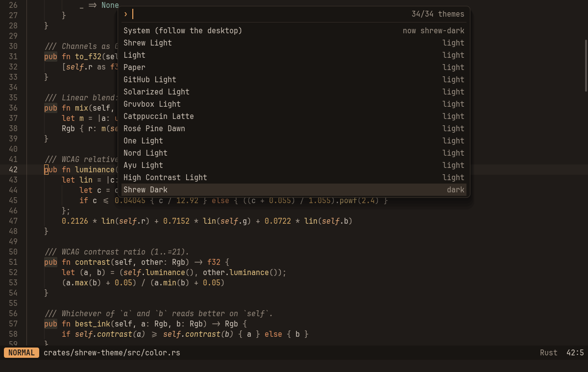

## Choosing a theme

| How | What happens |
| --- | --- |
| Palette *Theme: Select…* (`:theme` with no argument, `:select_theme`) | A list of every theme. Moving through it shows each one live; Esc puts the old one back, Enter keeps it |
| Palette *Accent: Select…* (`:accent`) | The same for accents |
| `:theme dracula`, `:accent teal` | Switch directly |
| `[theme] name = "dracula"` in config.toml | The theme at startup (see [CONFIG.md](CONFIG.md#theme)) |

Whatever you pick with Enter or `:theme` is written to `config.toml` (`[theme] name` / `accent`), keeping your
comments and layout, so it survives a restart. Switching is instant: shrew caches shaped text without its colors, so
a new theme is just new colors on the next frame; syntax colors follow as soon as the highlighter has redone the
visible lines (a few milliseconds).

## Built-in themes

| id | Name | | Based on |
| --- | --- | --- | --- |
| `shrew-dark` | Shrew Dark | dark | shrew's default: warm browns, terracotta keywords, sage strings |
| `shrew-light` | Shrew Light | light | the same hues on warm paper |
| `light` | Light | light | Slinger's light palette |
| `paper` | Paper | light | warm paper tones |
| `github-light` | GitHub Light | light | GitHub's light editor theme |
| `solarized-light` | Solarized Light | light | Ethan Schoonover's Solarized |
| `gruvbox-light` | Gruvbox Light | light | morhetz/gruvbox |
| `catppuccin-latte` | Catppuccin Latte | light | Catppuccin palette and style guide |
| `rose-pine-dawn` | Rosé Pine Dawn | light | rosepinetheme.com |
| `one-light` | One Light | light | Atom's One Light |
| `nord-light` | Nord Light | light | Nord's Snow Storm and Frost on light |
| `ayu-light` | Ayu Light | light | ayu-theme/ayu-colors |
| `contrast-light` | High Contrast Light | light | WCAG AAA (7:1) |
| `dark` | Dark | dark | Slinger's dark palette |
| `midnight` | Midnight | dark | deep blue night |
| `solarized` | Solarized Dark | dark | Ethan Schoonover's Solarized |
| `github-dark` | GitHub Dark | dark | GitHub's dark editor theme |
| `dracula` | Dracula | dark | the Dracula spec palette |
| `nord` | Nord | dark | nordtheme.com |
| `gruvbox-dark` | Gruvbox Dark | dark | morhetz/gruvbox |
| `catppuccin-mocha` | Catppuccin Mocha | dark | Catppuccin palette and style guide |
| `catppuccin-frappe` | Catppuccin Frappé | dark | Catppuccin palette and style guide |
| `tokyo-night` | Tokyo Night | dark | tokyonight (night) |
| `one-dark` | One Dark | dark | Atom's One Dark |
| `monokai` | Monokai | dark | Monokai as in Sublime Text |
| `rose-pine` | Rosé Pine | dark | rosepinetheme.com |
| `ayu-mirage` | Ayu Mirage | dark | ayu-theme/ayu-colors |
| `ayu-dark` | Ayu Dark | dark | ayu-theme/ayu-colors |
| `everforest` | Everforest | dark | sainnhe/everforest (dark, medium) |
| `kanagawa` | Kanagawa | dark | rebelot/kanagawa (wave) |
| `synthwave-84` | Synthwave '84 | dark | Robb Owen's Synthwave '84 |
| `oceanic` | Oceanic | dark | Oceanic Next |
| `contrast` | High Contrast | dark | WCAG AAA (7:1) |

The UI colors (backgrounds, borders, text tiers, accent, status colors) come from Slinger's palettes, so the two
apps look alike. The syntax colors follow each theme's own editor palette. Where an original color misses the
contrast targets (Dracula's and Tokyo Night's comments, Monokai's pink on the current line, most of Ayu Light), it is
made a little lighter or darker in the same hue; the theme file says so in a comment (`# lifted from #6272a4`). `shrew` and `solarized-dark` still work as names
for `shrew-dark` and `solarized`.

| | |
| --- | --- |
| 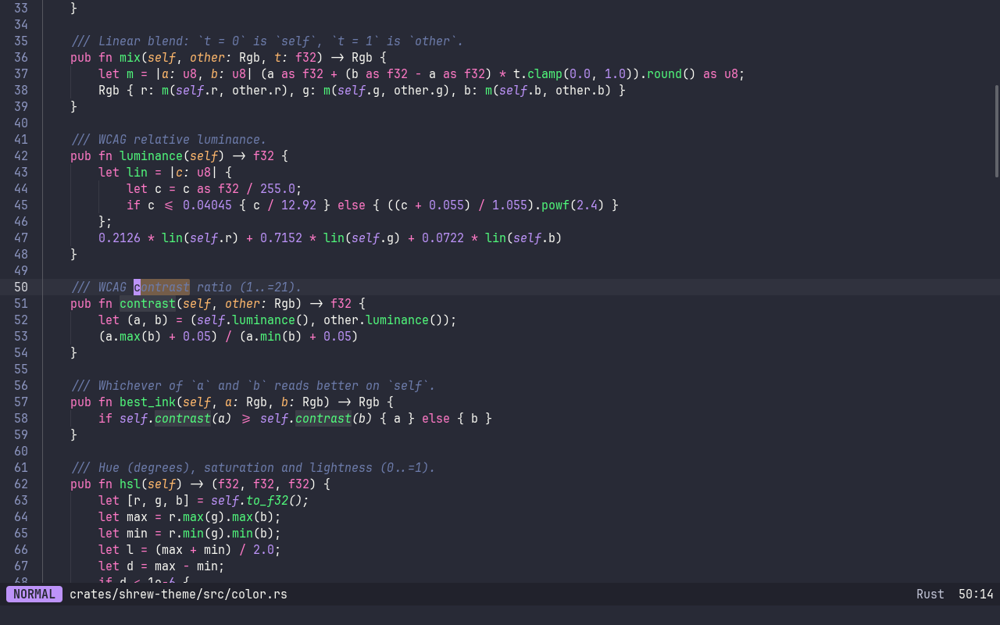 | 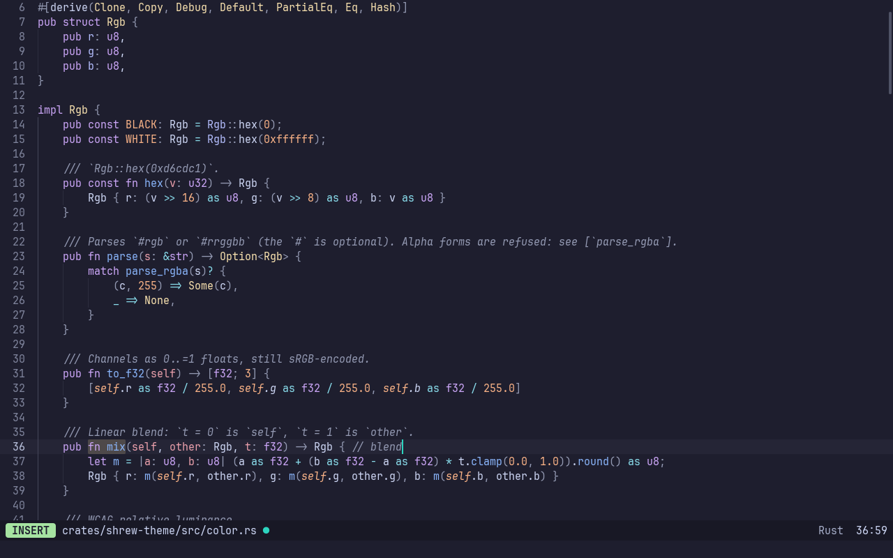 |
| `dracula`, searching | `catppuccin-mocha` + `teal`, insert mode |
| 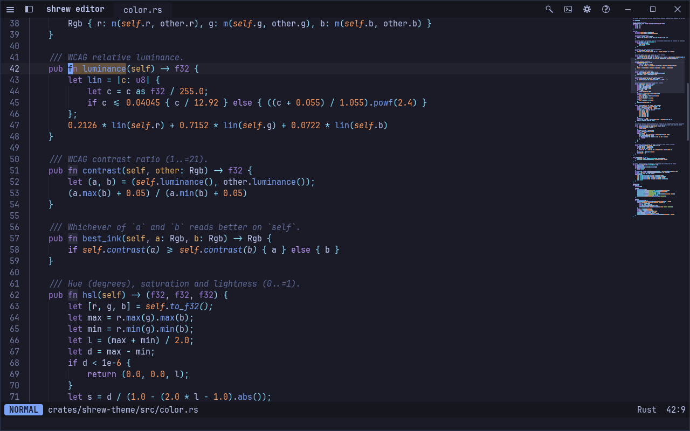 | 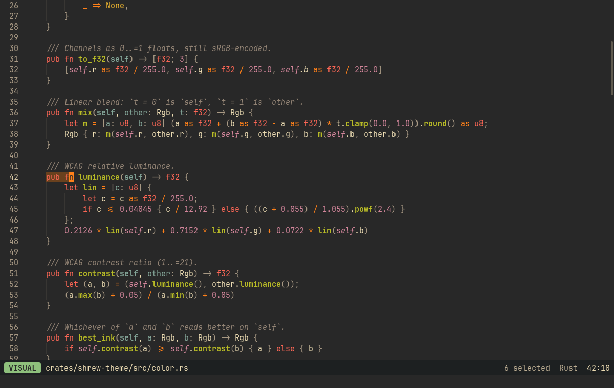 |
| `tokyo-night` | `gruvbox-dark`, visual mode |
| 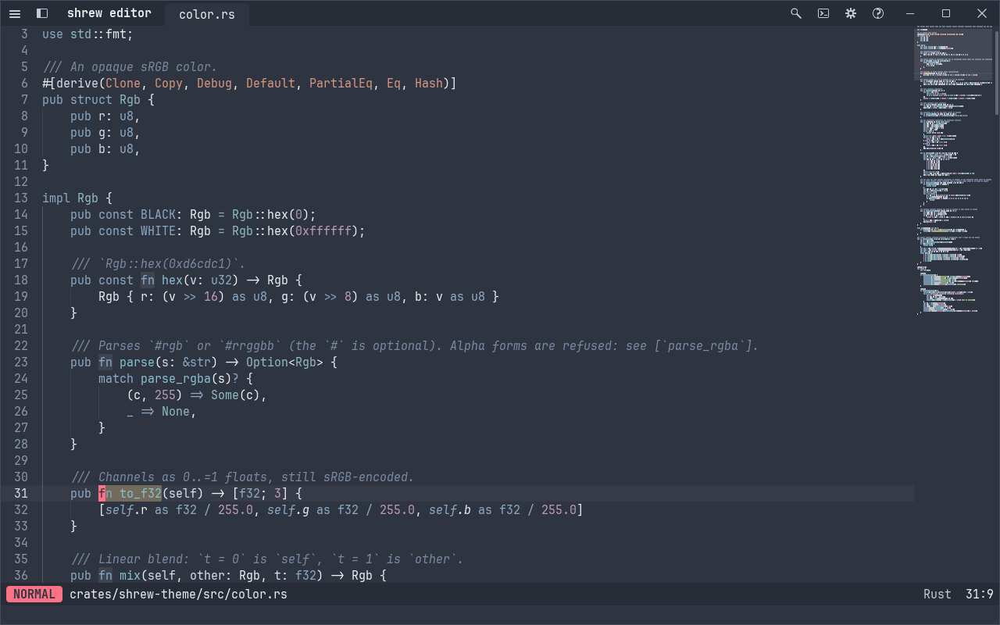 | 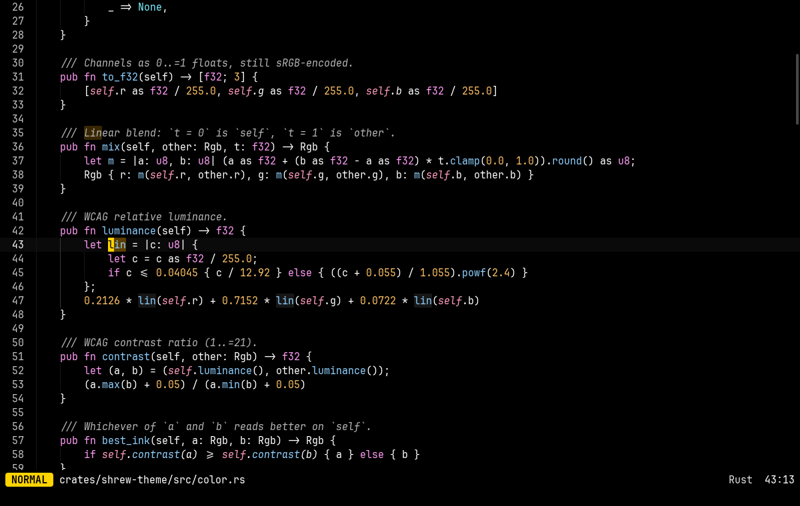 |
| `nord` + `rose` | `contrast` |
| 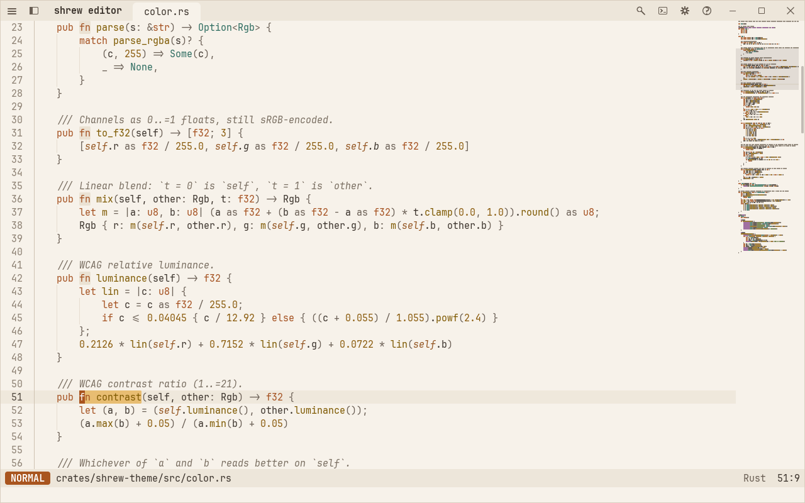 | 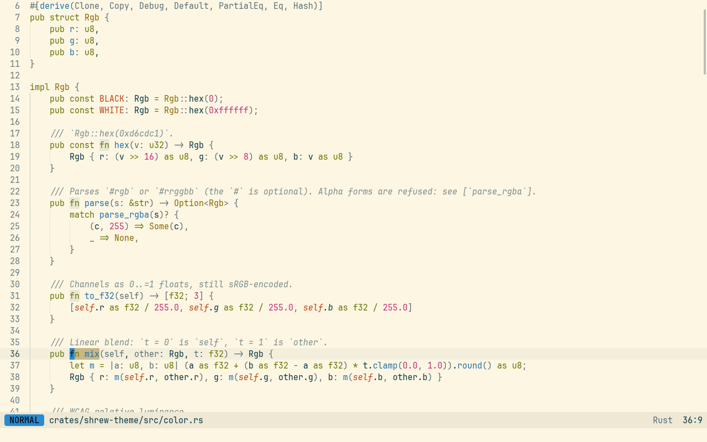 |
| `shrew-light` | `solarized-light` |
| 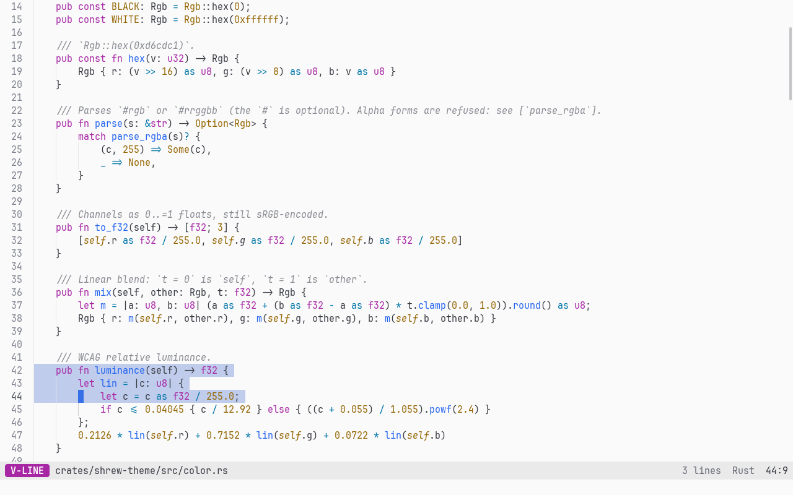 | 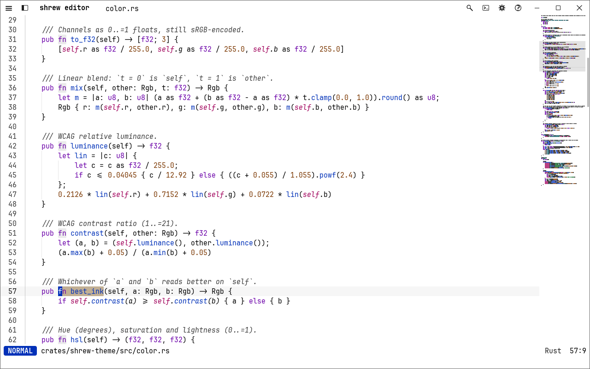 |
| `one-light`, visual line | `contrast-light` |
| 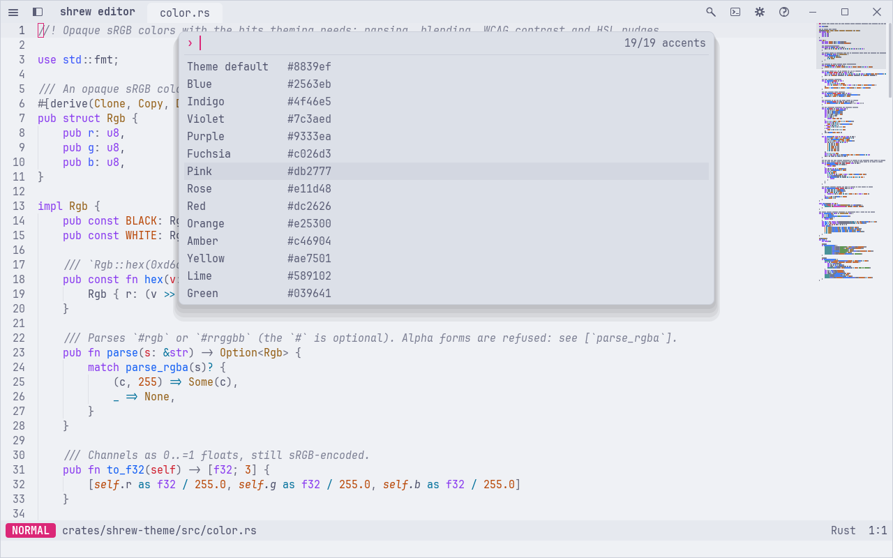 | |
| `catppuccin-latte`, accent picker previewing `pink` | |

## Accents

An accent replaces a theme's accent color: the cursor, the normal-mode badge, selections, matched letters in
pickers, the bracket match. Each comes in a light-theme and a dark-theme variant, picked by the theme's scheme.

`theme` (the theme's own, the default), `blue`, `indigo`, `violet`, `purple`, `fuchsia`, `pink`, `rose`, `red`,
`orange`, `amber`, `yellow`, `lime`, `green`, `emerald`, `teal`, `cyan`, `sky`, `slate`.

On the high-contrast themes an accent is pushed towards the text color so it keeps 7:1. The insert and visual mode
badges keep away from the accent's hue (and from red, which reads as an error), so the three modes never look alike.

## Following the desktop

```toml
[theme]
name = "system"
system_light = "github-light"   # default: shrew-light
system_dark = "tokyo-night"     # default: shrew-dark
```

shrew then switches between the two when the desktop switches between light and dark. On macOS and Windows it asks
the window system. On Linux it asks the XDG desktop portal (`org.freedesktop.appearance color-scheme`, which GNOME,
KDE and most others implement) through `gdbus`, and keeps listening for changes; until the portal answers, GTK's
`settings.ini` or KDE's `kdeglobals` decide (and they stay in charge without a portal). With nothing to go by,
shrew uses the dark theme.

## Custom themes

A custom theme is a TOML file in the `themes` folder next to `config.toml`: `~/.config/shrew/themes/<id>.toml` on
Linux, `~/Library/Application Support/shrew/themes/` on macOS, `%APPDATA%\shrew\themes\` on Windows. The file name
is the id: `themes/mine.toml` is `:theme mine`. Custom themes appear in the theme picker under the built-in ones.

A theme starts from a `base` theme and changes what it lists. Everything it does not set comes from the base, and
the colors derived from others are worked out again from the new values: change `bg` and the current line, gutter,
indent guides and search highlights follow. Colors the base sets itself (the built-ins set their surfaces, text
tiers, accent, selection and status colors) stay as they are unless you set them too. Without a `base` a theme stands
alone and everything unset is derived from `bg`, `text` and `accent`.

Saving a custom theme in shrew reloads it at once, so you can tune it with the theme on screen. Mistakes (an unknown
key, a malformed color) are reported in the status line with their line number; the rest of the file still applies.

A theme may have the same id as a built-in one: `themes/nord.toml` with `base = "nord"` adjusts Nord in place.

### Example

```toml
# ~/.config/shrew/themes/night-owl.toml
name = "Night Owl"
scheme = "dark"           # "light" or "dark"; used for accents and "system"
base = "tokyo-night"      # any built-in or custom id (optional)
# high_contrast = true    # hold it to WCAG AAA in the contrast audit

[ui]
bg = "#011627"
surface = "#01111d"       # tab and status bars
text = "#d6deeb"
accent = "#7fdbca"
selection = "#1d3b53"

[syntax]
keyword = { fg = "#c792ea", italic = true }
string = "#ecc48d"
comment = "#637777"
function = "#82aaff"
type = "#ffcb8b"
```

Colors are `"#rrggbb"` (or `"#rgb"`). A syntax role is either a color or a table with `fg` and any of `bold`,
`italic`, `underline`; a role without a table keeps its usual style (italic comments, bold headings, underlined
links). Keys may be written `surface-raised` or `surface_raised`.

### UI tokens

| Token | Used for | Derived from |
| --- | --- | --- |
| `bg` | the text area | |
| `surface` | tab bar, status bar | `bg` |
| `surface-raised` | raised panels | `bg`, `text` |
| `surface-hover` | the selected row in pickers | `bg`, `text` |
| `border`, `border-strong` | borders | `bg`, `text` |
| `text` | text | |
| `text-muted` | paths, hints, the file type (4.5:1) | `text`, `bg` |
| `text-faint` | the faintest hints (3:1) | `text`, `bg` |
| `accent` | the accent fill | |
| `accent-fg` | text on the accent | the better of dark and white |
| `accent-soft` | tinted backgrounds | `accent`, `bg` |
| `accent-text` | accent-colored text, matched letters in pickers | `accent` |
| `selection`, `selection-inactive` | selections (focused / unfocused window) | `accent`, `bg` |
| `cursor`, `cursor-fg` | the cursor and the letter under a block cursor | `accent` |
| `current-line` | the cursor's line | `bg`, `text` |
| `gutter`, `line-number`, `line-number-active` | the line-number gutter | `bg`, `text-faint`, `text-muted` |
| `indent-guide`, `indent-guide-active` | indent guides | `bg`, `text` |
| `whitespace` | visible tabs and trailing spaces | `bg`, `text` |
| `bracket-match` | behind the matching bracket | `accent` |
| `search-match`, `search-current` | search matches, the one at the cursor | `warning` |
| `word-highlight` | other occurrences of the word under the cursor | `text` |
| `danger`, `danger-fg`, `danger-soft` | errors | |
| `success`, `success-fg`, `success-soft` | success | |
| `warning`, `warning-soft` | warnings, macro recording | |
| `info` | cursor count, MCP marker | the `type` syntax color |
| `mode-normal`, `mode-insert`, `mode-visual` (and `-fg` for each) | the vim mode badge | `accent`, `success`, the `keyword` syntax color |
| `scrollbar` | the scrollbar thumb | `bg`, `text` |
| `popup`, `popup-border` | pickers and the command palette | `surface-raised`, `border` |
| `shadow` | the shadow under popups (drawn translucent) | black |
| `git-added`, `git-modified`, `git-deleted` | change markers in the gutter, file names and letters in the sidebar | the `diff-added`, `diff-changed` (or `warning`, blue, yellow: whichever stands apart) and `diff-removed` syntax colors |
| `git-renamed`, `git-untracked`, `git-conflict` | renamed, untracked and conflicted files | the theme's cyan, `git-added` towards cyan, the theme's magenta |
| `git-ignored` | ignored files | `text-faint` |
| `diff-add-bg`, `diff-del-bg` | behind added and removed lines (the hunk peek, diff views) | `git-added`, `git-deleted`, `bg` |
| `diff-add-word`, `diff-del-word` | behind the words that changed inside a changed line | `git-added`, `git-deleted`, `bg` (stronger) |
| `ansi-black`, `ansi-red`, `ansi-green`, `ansi-yellow`, `ansi-blue`, `ansi-magenta`, `ansi-cyan`, `ansi-white`, and `ansi-bright-*` for each | the terminal's 16 colors | the theme's own color nearest each hue (status colors, then syntax roles), readable on `bg`; greys from `bg` and `text` |

Derived tints are kept readable: a derived selection, search highlight or soft background is made paler until text
on it still reaches 4.5:1.

### Syntax roles

| Role | Typical scopes | Usual style |
| --- | --- | --- |
| `keyword` | `keyword`, `storage`, `fn`, `struct` | |
| `control` | `if`, `return`, `match` (`keyword.control`) | |
| `string` | strings, raw markdown | |
| `string-escape` | `\n`, format placeholders | |
| `number` | numbers | |
| `constant` | `true`, `None`, constants, `self` (italic) | |
| `comment`, `doc-comment` | comments, `///` docs | italic |
| `function`, `method` | definitions and calls | |
| `type`, `builtin-type` | types, classes, traits / `u32`, `int` | |
| `property` | fields, object and config keys | |
| `variable`, `parameter` | variables, function parameters | |
| `namespace` | modules, paths | |
| `macro` | macros, preprocessor, lifetimes (italic) | |
| `attribute` | `#[derive]`, decorators, HTML attribute names | |
| `tag` | HTML/XML tags | |
| `operator`, `punctuation` | operators, brackets and separators | |
| `regex` | regular expressions | |
| `heading`, `link`, `emphasis` | markdown | bold, underline, bold/italic |
| `diff-added`, `diff-removed`, `diff-changed` | diffs | |
| `invalid` | invalid code | underline |

The exact selectors are in [`crates/shrew-theme/src/scopes.rs`](../crates/shrew-theme/src/scopes.rs); the most
specific selector wins, as in Sublime Text. The built-in theme files in
[`crates/shrew-theme/themes/`](../crates/shrew-theme/themes) set every role and make good starting points.

## Importing Sublime and TextMate schemes

```
:theme import ~/Downloads/Mariana.sublime-color-scheme
:theme import ~/themes/Cobalt.tmTheme
```

This converts the scheme into a custom theme (`themes/<name>.toml`), switches to it and saves the choice. The
scheme's globals become UI tokens (background, foreground, caret, selection, line highlight, gutter, guides) and each
syntax role takes the color the scheme gives that role's typical scope, with Sublime's specificity rules. Sublime's
`variables`, `var()`, `rgb()`/`rgba()`, `hsl()`/`hsla()`, CSS color names and `color()` with `alpha()`, `blend()`,
`lightness()` and `saturation()` are understood; translucent colors are flattened onto the background. Roles the
scheme does not color are derived. The status line says how many contrast checks the result misses, if any: an
imported theme is yours to tune, so these are warnings, not errors.

Color schemes in Sublime Text's `Packages/User` folder are listed in the theme picker without importing them first
(marked *import*); choosing one imports it. `theme = "/path/to/Scheme.sublime-color-scheme"` in config.toml also
works and converts the file at startup.

When shrew imports Sublime's settings (see [CONFIG.md](CONFIG.md#import)), a `color_scheme` naming a theme shrew has
built in (Monokai, Dracula, Solarized, Gruvbox, Catppuccin, Nord, One Dark, Ayu, Tokyo Night, ...) becomes that
theme.

## Contrast

`cargo test -p shrew-theme` checks every built-in theme with its own accent and with each of the 18 accents, like
Slinger's theme tests. The pairs and targets ([`audit.rs`](../crates/shrew-theme/src/audit.rs)):

| What | On | Target |
| --- | --- | --- |
| `text` | `bg`, `surface`, `surface-raised`, `surface-hover`, `current-line`, `selection`, `accent-soft`, `bracket-match`, `search-match`, `search-current`, `word-highlight`, `popup`, the soft status backgrounds | 4.5:1 |
| `text-muted` | `bg`, `surface`, `surface-raised`, `popup` | 4.5:1 |
| every syntax role but comments | `bg`, `current-line` | 4.5:1 |
| comments, doc comments | `bg`, `current-line` | 3:1 |
| `accent-fg` on `accent`, badge text on each mode badge, `cursor-fg` on `cursor`, status text on its fill | | 4.5:1 |
| `accent-text` | `bg`, `surface`, `accent-soft`, `popup` | 4.5:1 |
| `danger`, `success`, `warning` | `bg`, `surface`, their soft backgrounds | 4.5:1 |
| `git-added`, `git-modified`, `git-deleted`, `git-renamed`, `git-untracked`, `git-conflict` | `bg`, `gutter`, `surface`, `surface-hover` | 4.5:1 |
| `text` on `diff-add-bg`, `diff-del-bg`, `diff-add-word`, `diff-del-word` | | 4.5:1 |
| `text-faint`, `git-ignored`, `line-number`, the cursor and accent fill against the background, matched letters on the selected picker row | | 3:1 |

Comments are held to 3:1, not 4.5:1: they are meant to recede, nearly every classic palette puts them close to 3:1,
and 3:1 is WCAG's minimum for large and non-text content. Syntax colors are not checked on the selection: it is a
tint behind text and is held to 4.5:1 against plain text. High-contrast themes (`high_contrast = true`) need 7:1
wherever the table says 4.5:1, and 4.5:1 where it says 3:1.

Custom and imported themes are audited too, but only reported (the import message, and `audit::audit` for tools).

## Fonts

```toml
[font]
family = "JetBrains Mono"   # "monospace" = the bundled JetBrains Mono
size = 15.0
line_height = 1.4
weight = "regular"          # "regular", "medium", "bold", ... or 100-900
ligatures = true
```

| How | What happens |
| --- | --- |
| Palette *Font: Select…* (`:font`) | Every installed monospace family, live as you move; Esc puts the old one back, Enter keeps it and saves it |
| `:font Iosevka` | Switch directly (saved) |
| Ctrl+= / Ctrl+- (Ctrl+wheel) | Bigger / smaller, saved as `[font] size` |
| Ctrl+0 | Back to the default size (15), saved |
| `:set ligatures`, `:set noligatures`, `:set ligatures!`, palette *Font: Toggle Ligatures* | Programming ligatures (`->`, `!=`, `>=`) in fonts that have them, saved |

The first frame always uses the bundled JetBrains Mono, so startup never waits for a font scan. Installed fonts are
scanned on a background thread; the font list is complete once the scan is done (well under a second), and a
configured system family takes over as soon as it is loaded. `weight` picks the weight of normal text where the
family has it (bold text is 300 heavier); the bundled JetBrains Mono has regular and bold, so `medium` looks like
regular there. A font change re-rasterizes the glyphs on screen: one slightly slower frame, then back to normal.
